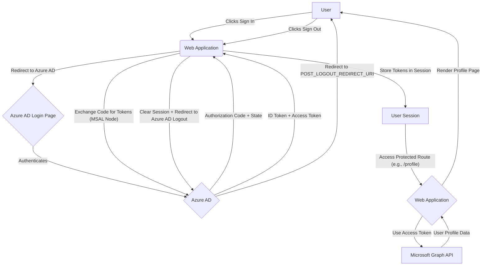

# SSO Azure Login

This repository contains a Node.js application demonstrating Single Sign-On (SSO) with Azure Active Directory (AAD) using the Microsoft Authentication Library (MSAL) for Node.js. It provides a basic web interface for users to sign in, view their ID token claims, and access their profile information from Microsoft Graph API.

## Table of Contents

- [Architecture](#architecture)
- [Features](#features)
- [Getting Started](#getting-started)
  - [Prerequisites](#prerequisites)
  - [Azure AD App Registration](#azure-ad-app-registration)
  - [Environment Variables](#environment-variables)
  - [Installation](#installation)
  - [Running the Application](#running-the-application)
- [Flow Diagram](#flow-diagram)
- [Trade-offs and Considerations](#trade-offs-and-considerations)
- [Project Structure](#project-structure)
- [Contributing](#contributing)
- [License](#license)

## Architecture

The application is built using Node.js with Express.js as the web framework and Handlebars (HBS) for templating. It leverages `@azure/msal-node` for handling authentication with Azure AD.

**Key Components:**

- **Express.js:** Handles routing, middleware, and serves static files.
- **MSAL Node:** Manages the OAuth 2.0 Authorization Code Flow with PKCE for secure authentication with Azure AD.
- **Express Session:** Used to maintain user session state, storing authentication tokens and user account information.
- **Handlebars (HBS):** A templating engine for rendering dynamic HTML views.
- **Dotenv:** Loads environment variables from a `.env` file.
- **Microsoft Graph API:** Accessed to retrieve user profile information after successful authentication.

**Authentication Flow:**

1.  **Initiate Sign-in:** When a user clicks "Sign In," the application redirects them to the Azure AD login page.
2.  **Azure AD Authentication:** The user authenticates with their Azure AD credentials.
3.  **Authorization Code Grant:** Upon successful authentication, Azure AD redirects the user back to the application's `redirect` endpoint with an authorization code.
4.  **Token Acquisition:** The application exchanges the authorization code for an ID token and an access token using MSAL Node's `acquireTokenByCode` method.
5.  **Session Establishment:** The acquired tokens and user account information are stored in the `express-session`.
6.  **Protected Routes:** Routes like `/users/profile` and `/users/id` are protected by an `isAuthenticated` middleware, ensuring only authenticated users can access them.
7.  **Microsoft Graph API Call:** For the profile page, the application uses the access token to call the Microsoft Graph API (`/v1.0/me`) to fetch additional user details.
8.  **Sign Out:** The sign-out process clears the local session and redirects the user to Azure AD's logout endpoint.

## Features

-   **Azure AD SSO:** Seamless authentication using Azure Active Directory.
-   **Authorization Code Flow with PKCE:** Secure authentication flow implemented with MSAL Node.
-   **User Profile Access:** Retrieve basic user profile information from Microsoft Graph API.
-   **ID Token Claims Display:** View the claims contained within the ID token.
-   **Session Management:** Maintains user session state after authentication.

## Getting Started

### Prerequisites

Before you begin, ensure you have the following installed:

-   Node.js (LTS version recommended)
-   npm (comes with Node.js)

### Azure AD App Registration

1.  **Register an Application:**
    -   Go to the [Azure portal](https://portal.azure.com/).
    -   Navigate to **Azure Active Directory** > **App registrations**.
    -   Click **New registration**.
    -   Give your application a name (e.g., `sso-azure-login`).
    -   For **Supported account types**, select "Accounts in any organizational directory (Any Azure AD directory - Multitenant) and personal Microsoft accounts (e.g. Skype, Xbox)".
    -   For **Redirect URI**, select `Web` and enter `http://localhost:3000/auth/redirect`.
    -   Click **Register**.

2.  **Client Secret:**
    -   In your newly registered app, go to **Certificates & secrets** > **Client secrets**.
    -   Click **New client secret**.
    -   Add a description and set an expiration.
    -   **Copy the `Value` of the client secret immediately** after it's generated. You will not be able to retrieve it again.

3.  **API Permissions:**
    -   In your app registration, go to **API permissions**.
    -   Click **Add a permission** > **Microsoft Graph** > **Delegated permissions**.
    -   Search for and select `User.Read`.
    -   Click **Add permissions**.
    -   Click **Grant admin consent for [Your Tenant Name]** (if you have admin privileges) or ask an administrator to grant consent.

4.  **Record Application Details:**
    -   From the **Overview** page of your app registration, note down the following:
        -   **Application (client) ID**
        -   **Directory (tenant) ID**

### Environment Variables

Create a `.env` file in the root of the project and populate it with the following variables:

```dotenv
# Azure AD Application (client) ID
CLIENT_ID="YOUR_APPLICATION_CLIENT_ID"

# Azure AD Directory (tenant) ID
TENANT_ID="YOUR_DIRECTORY_TENANT_ID"

# Client secret generated from your app registration
CLIENT_SECRET="YOUR_CLIENT_SECRET_VALUE"

# Cloud instance (e.g., https://login.microsoftonline.com/)
CLOUD_INSTANCE="https://login.microsoftonline.com/"

# Redirect URI configured in Azure AD app registration
REDIRECT_URI="http://localhost:3000/auth/redirect"

# Post-logout redirect URI
POST_LOGOUT_REDIRECT_URI="http://localhost:3000/"

# Microsoft Graph API endpoint
GRAPH_API_ENDPOINT="https://graph.microsoft.com/"

# Secret for Express session
EXPRESS_SESSION_SECRET="YOUR_EXPRESS_SESSION_SECRET"
```

Replace the placeholder values with your actual Azure AD application details and a strong secret for `EXPRESS_SESSION_SECRET`.

### Installation

1.  Clone the repository:
    ```bash
    git clone https://github.com/MatheusConstantino/azure-sso-login.git
    cd azure-sso-login
    ```
2.  Install dependencies:
    ```bash
    npm install
    ```

### Running the Application

To start the application, run:

```bash
npm start
```

The application will be accessible at `http://localhost:3000`.

## Flow Diagram



## Trade-offs and Considerations

-   **Session Management:** Using `express-session` with an in-memory store is suitable for development and small-scale applications. For production environments, consider a persistent session store (e.g., Redis, MongoDB) for scalability and reliability.
-   **Security:**
    -   **PKCE (Proof Key for Code Exchange):** Implemented to mitigate authorization code interception attacks, enhancing security for public clients. For confidential clients (like this Node.js app), PKCE is still a good practice.
    -   **CSRF Protection:** A basic CSRF token is implemented for the `redirect` endpoint. Ensure robust CSRF protection for all state-changing operations in a production application.
    -   **HTTPS:** Always use HTTPS in production to protect sensitive data in transit. The `cookie.secure` option in `express-session` should be set to `true` in production.
    -   **Environment Variables:** Never hardcode sensitive credentials. Use environment variables (e.g., `.env` file) and ensure they are not committed to version control.
-   **Error Handling:** Basic error handling is in place. For a production application, implement more comprehensive error logging, user-friendly error pages, and potentially integrate with an error monitoring service.
-   **Scalability:** The current setup is suitable for a single instance. For high-availability and scalability, consider load balancing, containerization (e.g., Docker, Kubernetes), and distributed session management.
-   **Logging:** MSAL Node's logger is configured for console output. Integrate with a proper logging framework (e.g., Winston, Pino) for structured logging in production.
-   **Database Integration:** The `package.json` includes `mysql2` and `sequelize`, suggesting potential future integration with a database. This could be used for storing user preferences, application-specific data, or linking Azure AD identities to internal user accounts. This current implementation does not utilize these dependencies.

## Project Structure

```
.
├── .gitignore
├── app.js                  # Main Express application setup
├── authConfig.js           # MSAL configuration and constants
├── Dockerfile              # Dockerization configuration
├── fetch.js                # Utility for making authenticated API calls (e.g., to Microsoft Graph)
├── Jenkinsfile             # Jenkins CI/CD pipeline configuration
├── LICENSE                 # Project license
├── package.json            # Project dependencies and scripts
├── README.md               # This documentation file
├── bin/
│   └── www                 # Entry point for starting the Node.js server
├── public/                 # Static assets (CSS, JavaScript, images)
│   └── stylesheets/
│       └── style.css       # Basic styling
├── routes/                 # Express route definitions
│   ├── auth.js             # Authentication routes (signin, redirect, signout)
│   ├── index.js            # Main application routes
│   └── users.js            # User-specific routes (profile, ID token claims)
└── views/                  # Handlebars templates
    ├── error.hbs           # Error page template
    ├── id.hbs              # ID token claims display template
    ├── index.hbs           # Home page template
    ├── layout.hbs          # Main layout template
    └── profile.hbs         # User profile display template
```

## Contributing

Contributions are welcome! Please feel free to open issues or submit pull requests.

## License

This project is licensed under the [MIT License](LICENSE).
